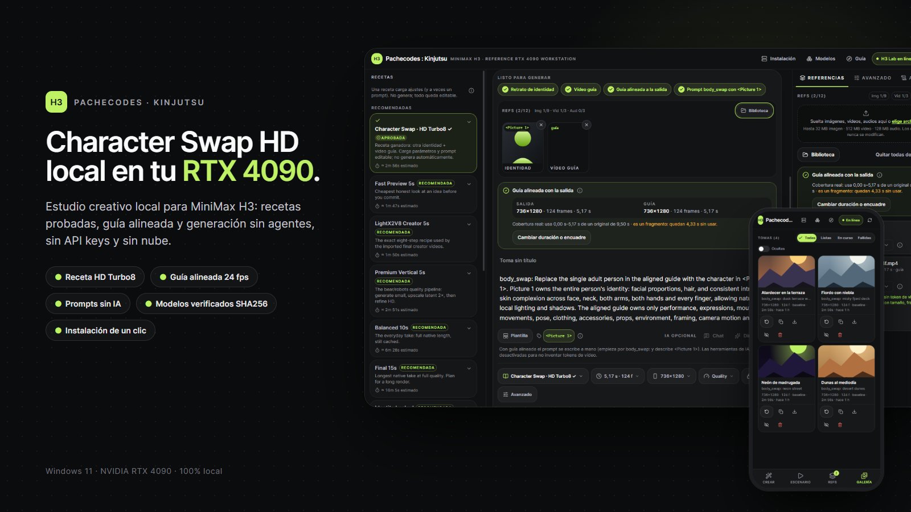
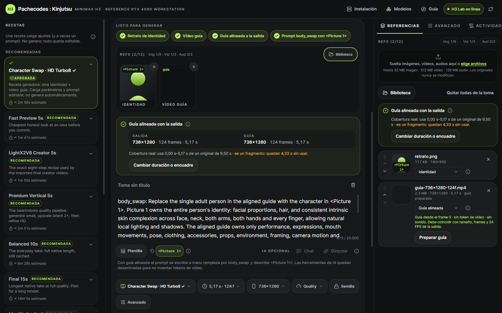
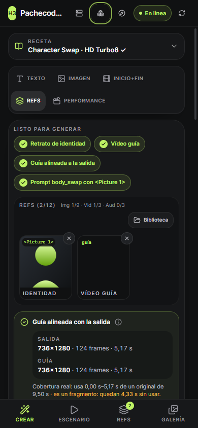
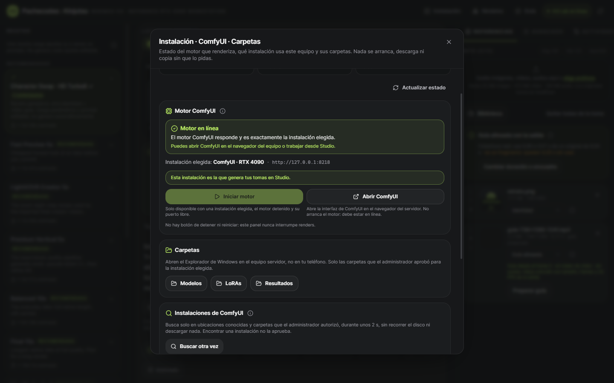
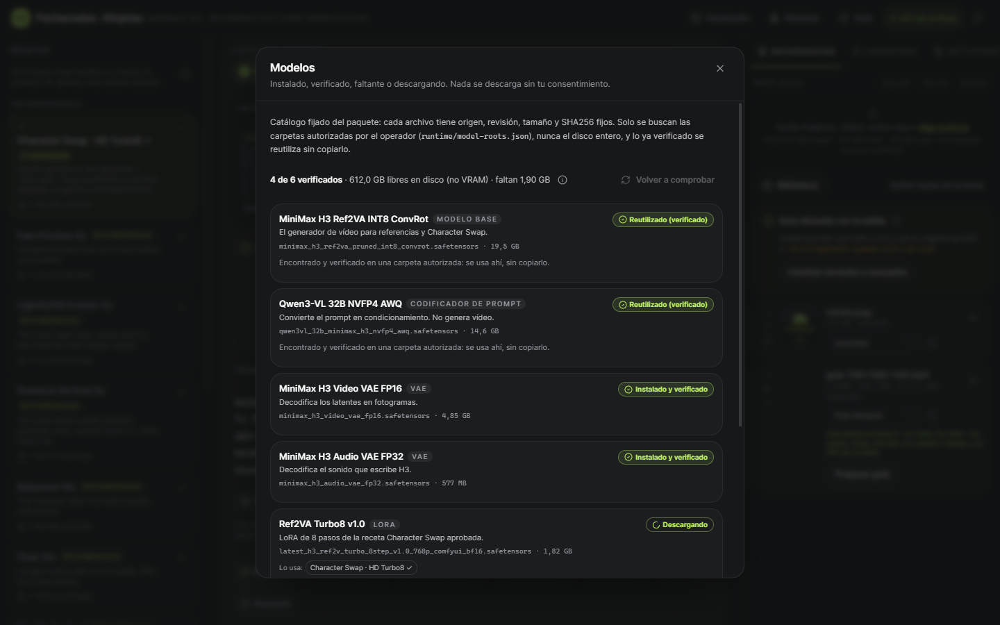

<p align="center">
  
</p>

<h1 align="center">Pachecodes : Kinjutsu</h1>

<p align="center">
  <strong>Character Swap HD en tu RTX 4090. Una carpeta, doble clic, instalación local sin agente.</strong><br/>
  Estudio creativo para MiniMax H3 con recetas probadas, guía alineada, modelos verificados por SHA256 y prompts sin IA.
</p>

<p align="center">
  
  
  
  
  
</p>

<p align="center">
  <a href="#lo-más-fácil">Empezar</a> ·
  <a href="#qué-necesitas">Requisitos</a> ·
  <a href="#la-receta">La receta</a> ·
  <a href="#el-estudio">El estudio</a> ·
  <a href="#licencias-y-límites">Licencias</a>
</p>

---

## ✦ Qué hace

| | |
|---|---|
| 🎭 **Character Swap HD Turbo8** | Cambia la persona de un vídeo guía por la identidad de un retrato, con la receta aprobada y el prompt editable. |
| 🎞️ **Guía alineada a 24 fps** | Prepara la guía con CPU al tamaño y los frames exactos de la salida; explica salida vs. guía vs. cobertura real del original. |
| ✍️ **Prompts sin IA** | Plantillas deterministas (Character Swap, Motion y los modos base): ordenan lo que escribes, sin agentes ni tokens. |
| 📦 **Modelos verificados** | Instala solo lo que falta, tras aceptar licencias; reutiliza pesos existentes por SHA256 sin copiarlos. |
| 🖥️ **Instalación y motor** | Busca instalaciones de ComfyUI, separa «Iniciar motor» de «Abrir ComfyUI» y abre carpetas en el equipo. Solo local. |
| 🧭 **Guía interactiva** | Recorrido opcional por todo el flujo, con ayudas en cada control y diseño para escritorio y móvil. |

## El estudio

<table>
  <tr>
    <td width="62%"></td>
    <td width="38%"></td>
  </tr>
  <tr>
    <td><sub><b>Ruta Character Swap.</b> Pasos de la receta, huecos Identidad y Vídeo guía, sincronía de la guía y prompt editable.</sub></td>
    <td><sub><b>Móvil.</b> Crear, Escenario, Refs y Galería.</sub></td>
  </tr>
  <tr>
    <td></td>
    <td></td>
  </tr>
  <tr>
    <td><sub><b>Instalación · ComfyUI · Carpetas.</b> Estado real del motor, instalaciones detectadas vs. aprobadas.</sub></td>
    <td><sub><b>Modelos.</b> Verificados, reutilizados, faltantes y descargas con licencia.</sub></td>
  </tr>
</table>

<sub>Capturas con datos de demostración: no contienen personas, rutas ni archivos reales.</sub>

## Antes de empezar

Incluye Studio sanitizado, manifiestos de los dos LoRA, workflows y scripts. No necesita Claude, Hermes, suscripciones ni claves API; Director/chat está desactivado por defecto.

> **Repositorio de código, sin pesos incluidos.** Copia o descarga todo este repositorio y abre `INICIAR.vbs`. El instalador descarga los seis artefactos fijados, incluidos los dos LoRA, solo si no están ya verificados en las carpetas autorizadas. No requiere agentes ni API keys. Las referencias históricas de verificación a dos LoRA incluidos corresponden al paquete portable local; aquí `included:false` es explícito para los seis. Los modelos no se alojan en GitHub.

## Lo más fácil

1. Copia **toda esta carpeta** a su ubicación definitiva y lee `THIRD_PARTY_NOTICES.md` y `licenses/`.
2. Abre `GUIA-SIMPLE.html` para la guía offline.
3. Doble clic en **`INICIAR.vbs`**: la primera vez pide licencias/descargas y verifica red, disco y controlador. Instala el runtime aislado y lo que falta; abre el navegador tras salud JSON real de Comfy y Studio.
4. Doble clic en **`DETENER.vbs`** para cerrar solamente procesos propios. Al volver a iniciar reutiliza servicios propios saludables con configuración idéntica; no reinstala si el runtime sigue válido.

Logs y errores: `runtime/logs/launcher.log`, `comfy.log`, `studio.log`. Un puerto extranjero ocupado produce error: nunca se mata ni adopta otro servicio. No se configura autoarranque ni túneles públicos. `START_HERE_AGENT.md` es ayuda opcional, no requisito.

Antes de instalar puede autorizar modelos existentes mediante `runtime/model-roots.json`: `{"roots":["X:/Models/ComfyUI/models"]}`. Solo nombres/targets exactos y tamaño+SHA256 completo, sin escaneo de disco, copias ni inferir integridad por tamaño. Se genera `runtime/extra_model_paths.yaml`. No se importa automáticamente YAML de otra instalación. No distribuya raíces privadas.

**42,470,585,471 bytes** base si faltan todos, más herramientas/dependencias. Recibos reales: `runtime/download-receipts/`. Descargas reanudables a `.part`; se promueven solo con tamaño+SHA256. Nunca se sobrescribe un final incorrecto: inspección manual. API y panel de catálogo/instalar/progreso/cancelar conectados; contrato en `docs/MODEL-MANAGER-API.md`. El panel muestra espacio libre en disco (no VRAM), descargas parciales reanudables y el texto de cada licencia antes de aceptar. La instalación inicial sigue descargando la base tras consentimiento; no existe aún un modo de instalación liviana que abra Studio sin modelos.

## Qué necesitas

- Windows11 de64bits y una NVIDIA RTX4090 de24GB.
- Driver NVIDIA compatible con el PyTorch/CUDA fijado en `dependencies/`.
- RAM:64GB recomendados;128GB dan margen.24GB VRAM no equivalen a toda la memoria del proceso.
- SSD con **120GB o más libres recomendados** para modelos, entorno, fuentes y resultados. El instalador comprueba el espacio real antes de descargar.
- Internet: el instalador descarga aproximadamente42.47GB de modelos base, además de Python/PyTorch y herramientas. Los dos LoRA se descargan si faltan (~2.04GB adicionales entre ambos).
- Una foto nítida de la persona de referencia y un video guía que tengas derecho a utilizar. Este paquete no incluye personas, fotos privadas ni videos de ejemplo.

## Arranque después de instalar

En PowerShell, desde esta carpeta:

```powershell
powershell -NoProfile -ExecutionPolicy Bypass -File .\scripts\Start-Kinjutsu.ps1
```

- **Studio:** http://127.0.0.1:8220
- **ComfyUI:** http://127.0.0.1:8218

Apagar:

```powershell
powershell -NoProfile -ExecutionPolicy Bypass -File .\scripts\Stop-Kinjutsu.ps1
```

No se instala autoarranque ni se publican servicios. Si un puerto ya está ocupado, el lanzador informa del conflicto sin matar otros procesos.

## La receta

**En Studio:** `Character Swap · HD Turbo8` es la receta ganadora y se carga por defecto en un composer vacío cuando está disponible. `Character Swap · Quality20 control` conserva 20 pasos como control, no como equivalente. La preparación CPU de guía permite pad/crop, inicio y duración personalizada normalizada (17k+5 fotogramas / 24 FPS); registra procedencia y permite alargar desde el original sin congelar/repetir el final. Todos los parámetros/métodos siguen editables; pesos y nodos opcionales faltantes no se declaran instalados. El grafo visual/API completo está en `workflows/`.


- MiniMaxH3 **Ref2VA pruned INT8 ConvRot**.
- Qwen3VL32B NVFP4AWQ como encoder.
- **Ref2VA Turbo8 v1.0 a1.0 → Character Swap v1.1 a1.0**.
- Euler / simple /8pasos / BasicGuider.
- Foto como `<Picture 1>`; video mediante guía **alineada** `MiniMaxH3AddGuide`.
-736x1280 nativo →720x1280 por recorte lateral,24FPS, sin upscale.
- Primera prueba:124frames,5.17s. Una toma de aproximadamente10s también se probó;15–30s requieren validar memoria y calidad antes de usarlos como producción.

**No es un simple face-swap ni una garantía de manos perfectas.** Puede conservar partes de la persona original o cambiar detalles. Una guía de alta calidad ayuda. No elevar fuerzas a ciegas.

## Qué hay en cada carpeta

- `START_HERE_AGENT.md`: asistencia opcional para agentes; no es requisito.
- `GUIA-SIMPLE.html`: explicación sencilla para ti, sin Internet.
- `studio/`: H3 Studio limpio, sin historial ni datos del equipo original.
- `scripts/`: instalación, verificación, arranque y parada.
- `dependencies/` y `runtime/`: versiones y compatibilidad del motor, incluido AddGuide.
- `models/manifest.json`: URLs fijadas, tamaños y SHA256 de cada modelo.
- `models/manifest.json`: Character Swap v1.1 y Turbo8 fijados como descargas, sin pesos en Git.
- `workflows/`: grafo completo ComfyUI y plantilla para API Studio.
- `skills/`: procedimientos generalizados para instalación, operación, prompts y QA.
- `tests/`: pruebas repetibles. `licenses/` y `THIRD_PARTY_NOTICES.md`: términos de terceros.

## Comfy existente y carpetas

El backend incluye búsqueda acotada de instalaciones, selección autorizada, inicio/apertura de Comfy y apertura de carpetas Modelos/LoRAs/Resultados. Contrato: `docs/WORKSTATION-API.md`; encargo visual: `docs/CLAUDE-WORKSTATION-UI.md`. En Studio aparecen en el botón **Instalación** (detalles en `docs/CLAUDE-WORKSTATION-UI-RESULT.md`).

Son acciones **locales**: solo loopback, Host y Origin válidos. No se exponen como control remoto por Tailnet. No hay stop/restart, no se matan procesos ajenos ni se copian pesos. La instalación propia verificada genera un perfil aprobado si falta; otras instalaciones detectadas requieren aprobación administrativa. Seleccionar una instalación no cambia automáticamente la ruta de generación de Studio: revisar `generation_binding` y configurar la URL al estar idle.

Para verificar este checkout con runtime privado ignorado por Git, primero stagear los archivos de código y ejecutar `python scripts/release_gate.py --git-tracked --write-inventory --verify-inventory`. El inventario no incorpora configuración local, recibos, logs ni datos ignorados. Un clon limpio también admite la verificación completa sin esa opción.

## Prompts sin agente ni tokens

`prompting/` incluye seis plantillas deterministas: Character Swap alineado, Motion Ref2VA y los cuatro modos Base. Se pueden usar desde `scripts/build_prompt.py` o mediante `GET /api/prompting/catalog` y `POST /api/prompting/build`. La guía está en `prompting/README.es.md` y el contrato para integrar formularios en `prompting/INTEGRATION.md`. Los skills completos se incluyen como referencia opcional, no como dependencia para generar.

Estas plantillas organizan las descripciones que tú proporcionas; no ven tus archivos ni traducen automáticamente. Preview/Apply debe ser explícito. No cambian los LoRA, la receta ni lanzan renders. El formulario visual de prompts está conectado, junto con la organización de recetas, tooltips, tour y panel de modelos. Ver `docs/UI-INTEGRATION.md` para las comprobaciones y límites. Esta actualización del paquete no activa automáticamente la nueva UI en otra instalación o en la aplicación fuente.

## Audio y español

Esta receta usa guía visual **sin copiar el audio original**. El audio de salida lo genera H3. El movimiento de boca puede seguir al original, pero eso no garantiza sincronización de palabras. Conservar audio original o usar otra voz es una operación separada. No se ha certificado esta receta para generar diálogo español exacto; si necesitas español, define primero el origen de la voz y verifica el resultado escuchándolo.

## Licencias y límites

**Antes de instalar o compartir:** la licencia pública de H3 excluye EE. UU., UE, Reino Unido y Corea del Sur; allí indica que se debe obtener autorización separada de MiniMax. Esto aplica también a sus derivados. Consulta el texto completo en `licenses/MINIMAX-H3-LICENSE.txt`.

Uso local interno. La licencia BFS de Character Swap permite compartir los pesos con su licencia y crear medios comerciales, pero no revenderlos como producto independiente ni ofrecer su funcionalidad como API/SaaS hospedado. Consulta `THIRD_PARTY_NOTICES.md` para atribución y términos completos. Este proyecto no relicencia H3 ni modelos de terceros.

La receta tiene evidencia de ejecución en RTX4090. El paquete debe verificarse en tu equipo; no se afirma haber completado una instalación desde cero en una segunda computadora. Consulta `VERIFICATION.md` para las comprobaciones reales de esta distribución.
